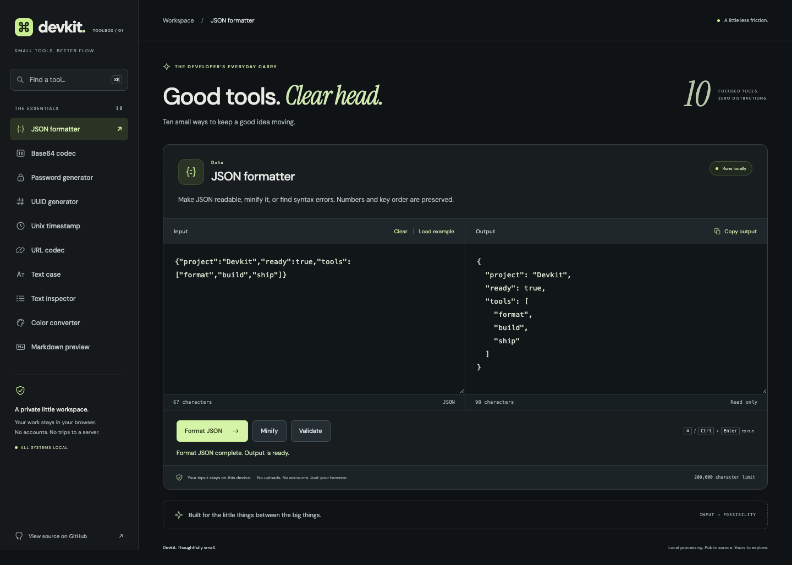

# Devkit — Good tools. Clear head.

Ten focused developer utilities in one private browser workspace. Format data, generate secure values, inspect text, convert colors, and preview Markdown without an account or a backend.



## Tools

| Tool | Implemented behavior |
| --- | --- |
| JSON formatter | Pretty-print, minify, and validate. Preserves number literals, duplicate keys, and key order instead of silently changing data. Helpful syntax errors. |
| Base64 codec | UTF-8 encoding and decoding, including emoji and non-Latin text. Rejects malformed Base64 and invalid UTF-8. |
| Password generator | 8–128 characters using Web Crypto, all four character classes, rejection sampling, and a randomized shuffle. Ambiguous characters are excluded. |
| UUID generator | 1–100 cryptographically random UUID v4 identifiers using `crypto.randomUUID()`. |
| Unix timestamp | Seconds or milliseconds to UTC; ISO dates with explicit offsets to seconds or milliseconds. Fractional seconds, negative epochs, and leap-year validation. |
| URL codec | Encode/decode URL components with clear malformed-escape and Unicode errors. Literal `+` stays `+`; this is not a form-query decoder. |
| Text case | Lowercase, uppercase, title case, camelCase, and snake_case. Handles acronyms, Unicode, and contractions. |
| Text inspector | Live words, visible characters, lines, reading time, Unicode code points, and UTF-8 bytes. Reading time assumes 200 words/minute. |
| Color converter | HEX ↔ RGB ↔ HSL, including shorthand, alpha, percentages, and comma/space CSS syntax. Color picker, swatches, and explicit range validation. |
| Markdown preview | Live CommonMark/GFM headings, emphasis, lists, code, tables, tasks, and links. Safe rendering with HTML and remote images disabled. |

Search by tool, category, or keyword. Each workspace retains its draft and result while switching tools. Editing invalidates stale output, and clipboard feedback cannot race a newer result. Fonts are bundled locally; utilities never call external APIs.

## Stack and architecture

React 19, TypeScript 6 in strict mode, and Vite 8. Native Web APIs handle encoding, segmentation, cryptography, and clipboard access. Markdown is parsed by [react-markdown](https://github.com/remarkjs/react-markdown) and `remark-gfm`; no raw HTML injection or custom regex Markdown parser is used.

Pure utility modules live in `src/tools/`. A typed registry drives navigation, search, icons, and shared workspace components. The Markdown renderer loads only when its tool is opened. Reusable editors, buttons, notifications, and the workspace state hook keep UI behavior consistent.

See [architecture](docs/architecture.md) and the [repository audit](docs/audit.md) for design decisions, risk controls, and verification details.

## Local setup

Use **Node.js 22.13+**; the latest Node 22 release is recommended. With nvm:

```sh
git clone https://github.com/QuantumGod007/devkit-utilities.git
cd devkit-utilities
nvm use
npm ci
npm run dev
```

Open the local URL printed by Vite. No environment variables, credentials, database, or API keys are needed.

## Commands and testing

| Script | Purpose |
| --- | --- |
| `npm run dev` | Local development with hot reload |
| `npm run lint` | ESLint, React hooks rules, zero warnings allowed |
| `npm run typecheck` | Type-check application, tests, and build configuration |
| `npm test` | Unit and edge-case tests using Node's test runner |
| `npm run check` | Lint, type-check, and unit tests |
| `npm run build` | Type-check and produce the static `dist/` bundle |
| `npm run preview` | Serve the production bundle with production security headers |
| `npm run test:e2e` | Playwright workflows, Markdown security, responsive layouts, and axe WCAG AA checks |

Install a browser before running the browser suite:

```sh
npx playwright install chromium
npm run check
npm run build
npm run test:e2e
```

Tests use a dedicated production preview on port 4190, run with the deployed Content Security Policy, and do not reuse unrelated servers. Chrome is detected automatically on macOS; `PLAYWRIGHT_CHROMIUM_EXECUTABLE` can select another Chromium binary. Automated responsive checks cover 320, 390, 768, and 1440 pixel widths. Accessibility checks supplement keyboard and visual review; they do not constitute accessibility certification.

GitHub Actions runs the same checks, build, production dependency audit, and Chromium suite on pushes to `main` and pull requests. Action versions are pinned to verified commit SHAs.

## Keyboard access

- **Cmd/Ctrl + K:** focus tool search.
- **Arrow Down from search:** focus the first matching tool.
- **Up/Down, Home/End in navigation:** move between tools; Enter/Space selects one.
- **Enter in search:** open the first matching tool.
- **Escape in search:** clear the query.
- **Cmd/Ctrl + Enter:** run the primary utility action; Enter also runs numeric generators.
- **Tab:** reach every editor, action, copy control, and the skip link.

Tool IDs in the URL, such as `/#color` and `/#markdown`, support bookmarking, refresh, and browser history. Inputs never enter the URL.

## Deploy to Vercel or Netlify

This is a static application. Connect this repository and deploy `main` using:

| Setting | Value |
| --- | --- |
| Framework | Vite |
| Install | `npm ci` |
| Build | `npm run build` |
| Publish/output | `dist` |
| Node | 22 |
| Environment variables | None |

- **Vercel:** the committed [`vercel.json`](vercel.json) defines installation, build, output, security headers, and immutable caching for hashed assets. [Configuration reference](https://vercel.com/docs/project-configuration/vercel-json).
- **Netlify:** the committed [`netlify.toml`](netlify.toml) defines build/publish settings, Node 22, the same headers, and asset caching. [Configuration reference](https://docs.netlify.com/build/configure-builds/file-based-configuration/).

Hash-based tool links work on static hosting without SPA rewrite rules. Use HTTPS for the Clipboard API and UUID generation. To deploy elsewhere, serve `dist/` and reproduce the headers in `deployment/security-headers.ts`.

The production CSP allows local scripts and fonts, blocks network connections and embedding, and permits inline CSS only for validated color swatches. Development remains separate so Vite hot reload works. Host preview toolbars or analytics must be removed or explicitly reviewed against this policy. Hosting account connection, a production domain, and a live deployment are not created by this repository.

## Privacy and limits

- Drafts and results stay in memory; switching tools preserves them, refreshing clears them. No cookies, storage persistence, analytics, or background uploads are used.
- Markdown HTML and images never render as executable/raw content or trigger image requests. Links allow only HTTP, HTTPS, mailto, and in-page anchors; relative links are shown as text. Opening an external link is an explicit user action.
- The color parser supports HEX/RGB/HSL, not named colors, CSS variables, Lab, or OKLCH. Alpha is preserved with 8-bit rounding when exporting HEX.
- Text editors accept up to 200,000 UTF-16 code units; Markdown accepts 50,000. Pretty-printing JSON is limited to 100 nested levels to bound output expansion; validation and minification remain available for deeper JSON.
- Reading time is an estimate, and visible character counts use Unicode grapheme segmentation.
- Browser automation targets Chromium. Modern browsers need Web Crypto, TextEncoder/TextDecoder, and Intl.Segmenter; unsupported secure-generation environments receive a helpful error.

Local font licenses are included in `public/fonts/` under the SIL Open Font License.
